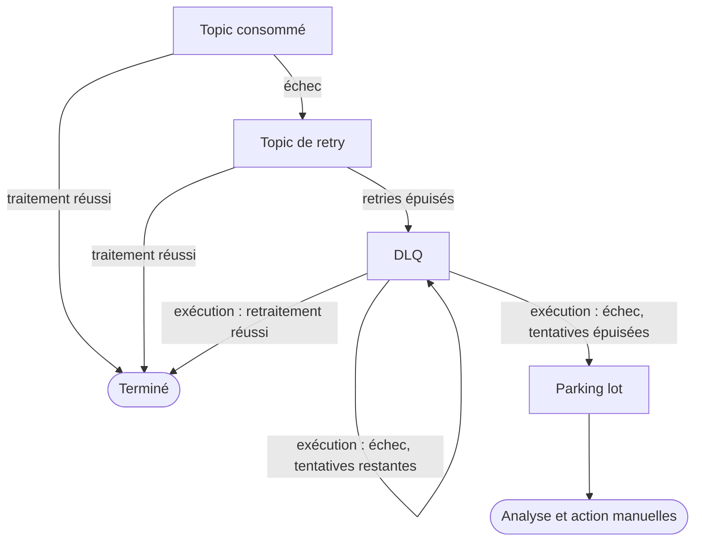

# Documentation fonctionnelle

Cette page décrit ce que fait `kafka-dlq-spring-boot-starter` du point de vue d'une équipe qui développe ou exploite
un service consommateur Kafka. Le fonctionnement interne est décrit dans la
[documentation technique](documentation-technique.md).

## 1. Objectif

Un service qui consomme un topic Kafka peut échouer à traiter un message : dépendance indisponible, donnée
inattendue, bug. La lib encadre ce qui arrive alors à ce message, de la première erreur jusqu'à son traitement ou sa
mise à l'écart définitive :

1. le message est retenté automatiquement sur un topic de retry ;
2. s'il échoue toujours, il est déposé dans une DLQ, où il attend ;
3. la DLQ est retraitée plus tard, sur décision, et jamais en continu ;
4. un message qui échoue encore au retraitement finit dans un topic parking lot, qui n'est jamais rejoué.

Aucun message n'est perdu ni rejoué en boucle.

## 2. Vocabulaire

| Terme | Définition |
|---|---|
| Topic consommé | Le topic métier lu par le service (`orders`). |
| Topic de retry | Topic technique où un message en échec est retenté après un délai. |
| DLQ (dead letter topic) | Topic où arrivent les messages qui ont épuisé leurs retries. Ils y attendent un retraitement. |
| Parking lot | Topic des messages en échec définitif. Il n'est lu par aucun traitement automatique. |
| Topic géré | Topic consommé déclaré dans la configuration `kafka.dlq.topics`. |
| Exécution | Un retraitement de la DLQ d'un topic géré, du démarrage à l'arrêt. |
| Message en attente | Message présent dans la DLQ et pas encore retraité. |
| Tentative | Un passage d'un message dans le traitement de retraitement, soldé par un échec. |

## 3. Parcours d'un message

Les deux premières étapes (retry puis DLQ) sont le comportement standard de Spring Kafka, piloté par l'annotation
`@RetryableTopic`. La lib prend la main à partir de la DLQ.

## 4. Retraitement de la DLQ

### 4.1 Principe

Le traitement qui lit la DLQ est arrêté par défaut. Les messages s'y accumulent sans être consommés. Une
**exécution** démarre ce traitement, lui fait traiter les messages en attente, puis l'arrête.

### 4.2 Déclenchement

Une exécution peut être lancée de deux façons.

**Sur planification (cron).** À chaque échéance, la lib vérifie les conditions de déclenchement. L'exécution ne
démarre que si toutes sont réunies :

| Condition | Paramétrage |
|---|---|
| La DLQ contient au moins N messages en attente | `min-pending-messages` (1 par défaut) |
| Toutes les conditions propres au service sont remplies | Règles fournies par le service : approbation enregistrée, feature flag, disponibilité d'un système aval, plage horaire... |

Si une condition n'est pas remplie, rien ne se passe et la vérification reprend à l'échéance suivante.

**À la demande.** Le service peut lancer une exécution immédiatement, par exemple depuis un écran ou un endpoint
d'administration. Les conditions ci-dessus ne s'appliquent pas : la demande vaut décision.

Dans les deux cas :

- rien ne démarre si la DLQ est vide ;
- une seule exécution à la fois par topic géré : une demande pendant une exécution en cours est refusée ;
- un topic sans cron n'est retraité qu'à la demande.

### 4.3 Périmètre d'une exécution

Une exécution ne traite que les messages **présents dans la DLQ au moment où elle démarre**. Les messages qui y
arrivent ensuite, y compris ceux que l'exécution elle-même y remet, attendent l'exécution suivante. Un message est
donc tenté au plus une fois par exécution.

### 4.4 Devenir de chaque message

| Situation | Résultat | Compté comme |
|---|---|---|
| Le retraitement réussit | Le message quitte la DLQ. | traité |
| Le retraitement échoue, il reste des tentatives | Le message est remis dans la DLQ, son compteur de tentatives augmente de 1. | en échec |
| Le retraitement échoue, `max-attempts` est atteint et un parking lot est configuré | Le message est déplacé dans le parking lot. | parqué |
| Le retraitement échoue et aucun parking lot n'est configuré | Le message reste dans la DLQ, quel que soit son nombre de tentatives. | en échec |
| Le message est écarté par une règle de sélection du service | Le message est remis dans la DLQ, inchangé. | ignoré |

Exemple avec `max-attempts: 3` et un parking lot : un message qui échoue systématiquement reste dans la DLQ après
les exécutions 1 et 2, puis part au parking lot à l'exécution 3.

### 4.5 Fin d'une exécution

| Cause | Signification |
|---|---|
| Terminée | Tous les messages présents au démarrage ont été traités. |
| Inactivité | Plus aucun message reçu pendant `idle-timeout` (30 s par défaut). |
| Durée maximale | `max-duration` est atteinte ; les messages restants attendent l'exécution suivante. |
| Arrêt demandé | Le service a interrompu l'exécution. |

### 4.6 Sélection des messages à rejouer

Le service peut fournir une règle qui décide, message par message, s'il doit être rejoué lors d'une exécution : par
exemple seulement ceux dont l'erreur d'origine est d'un certain type, ou ceux d'une période donnée. Les messages
écartés ne sont pas perdus : ils restent dans la DLQ pour une exécution ultérieure.

## 5. Parking lot

Le parking lot reçoit les messages que le retraitement n'a pas réussi à traiter après `max-attempts` tentatives.
Chaque message y arrive avec son contenu d'origine et les informations suivantes :

| Information | Contenu |
|---|---|
| Nombre de tentatives de retraitement | `x-dlt-reprocessing-attempts` |
| Type de la dernière erreur | `x-dlt-reprocessing-exception-fqcn` |
| Message de la dernière erreur | `x-dlt-reprocessing-exception-message` |
| DLQ d'origine | `x-dlt-parked-from` |

La lib ne lit jamais le parking lot. Son contenu relève d'une analyse et d'une action manuelles : correction de la
donnée, réinjection dans le topic consommé, abandon.

Le parking lot est optionnel. Sans lui, un message en échec reste dans la DLQ et sera retenté à chaque exécution.

## 6. Suivi

Pour chaque topic géré, le service peut connaître à tout moment :

- le nombre de messages en attente dans la DLQ ;
- si une exécution est en cours ;
- le bilan de la dernière exécution : déclencheur (cron ou demande), début, fin, cause de fin, nombre de messages
  traités, en échec, parqués et ignorés.

Chaque début et chaque fin d'exécution donnent lieu à un événement applicatif et à une ligne de log, que le service
peut relayer vers son outillage (audit, alerte, tableau de bord).

## 7. Plusieurs topics

Un service qui consomme plusieurs topics déclare chacun d'eux comme topic géré. Chaque topic a ses propres topics
de retry, DLQ et parking lot, sa propre planification et ses propres seuils. Les exécutions sont indépendantes :
retraiter la DLQ des commandes ne touche pas celle des paiements.

Des valeurs communes peuvent être définies une fois et surchargées topic par topic.

## 8. Démarche d'exploitation type

1. **Détecter.** Une alerte du service signale des messages en attente dans une DLQ.
2. **Analyser.** Lire les messages de la DLQ et leurs en-têtes d'erreur pour identifier la cause.
3. **Corriger.** Rétablir la dépendance, déployer le correctif ou corriger la donnée de référence.
4. **Décider.** Enregistrer l'approbation attendue par la condition de déclenchement, ou lancer l'exécution à la
   demande.
5. **Contrôler.** Lire le bilan de l'exécution. Les messages encore en échec sont restés dans la DLQ ou sont partis
   au parking lot.
6. **Traiter le parking lot.** Décider manuellement du sort des messages qui s'y trouvent.

## 9. Règles de gestion

| # | Règle |
|---|---|
| RG1 | La DLQ d'un topic géré n'est jamais consommée en dehors d'une exécution. |
| RG2 | Une exécution planifiée ne démarre que si toutes les conditions de déclenchement sont réunies. |
| RG3 | Une exécution à la demande ne dépend d'aucune condition, sauf la présence de messages en attente. |
| RG4 | Une seule exécution à la fois par topic géré. |
| RG5 | Une exécution ne traite que les messages présents dans la DLQ à son démarrage. |
| RG6 | Un message est tenté au plus une fois par exécution. |
| RG7 | Un message en échec n'est jamais supprimé : il reste dans la DLQ ou part au parking lot. |
| RG8 | Un message part au parking lot quand son nombre de tentatives atteint `max-attempts`, si un parking lot est configuré. |
| RG9 | Le parking lot n'est jamais rejoué automatiquement. |
| RG10 | Un message écarté par une règle de sélection reste dans la DLQ, sans consommer de tentative. |

## 10. Limites fonctionnelles

- **Ordre des messages.** Un message remis dans la DLQ est placé en fin de file. L'ordre d'arrivée n'y est pas
  conservé, et un message retraité tardivement peut être plus ancien que l'état courant du service. Le traitement
  de retraitement doit être idempotent et vérifier qu'il n'écrase pas une donnée plus récente.
- **Durée de conservation.** Les messages de la DLQ et du parking lot sont soumis à la rétention de leur topic. Elle
  doit couvrir le délai d'analyse et de correction.
- **Messages illisibles.** Un message de la DLQ qui ne peut pas être désérialisé n'est pas pris en charge par la
  lib : il suit le comportement standard de Spring Kafka.
- **Un consommateur par topic géré.** Le traitement d'un topic géré ne doit pas être partagé avec un autre topic.
