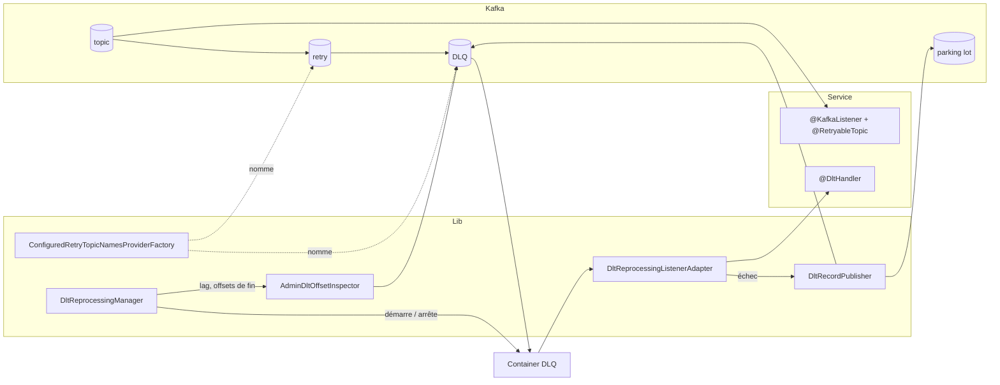
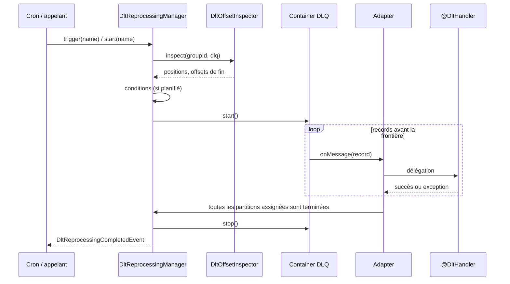

# Documentation technique

Fonctionnement interne de `kafka-dlq-spring-boot-starter`. Le comportement vu par le service est décrit dans la
[documentation fonctionnelle](documentation-fonctionnelle.md).

## 1. Vue d'ensemble

La lib est une auto-configuration Spring Boot qui se greffe sur le mécanisme de retry non bloquant de Spring Kafka
(`@RetryableTopic`, `@DltHandler`). Elle ne remplace ni les listeners ni le gestionnaire d'erreurs de Spring
Kafka ; elle intervient en trois points :

| Point d'intervention | Mécanisme Spring Kafka utilisé | Effet |
|---|---|---|
| Nommage des topics | Bean `RetryTopicComponentFactory` | Les topics de retry et de DLQ portent les noms configurés. |
| Cycle de vie des containers DLQ | `KafkaListenerEndpointRegistry`, `SmartLifecycle` | Les containers DLQ ne démarrent pas avec l'application. |
| Traitement des records DLQ | Décoration du `MessageListener` du container | Périmètre d'exécution, remise en DLQ, parking lot. |



Prérequis : Java 17, Spring Boot 3.x ou 4.x, Spring Kafka, un bean `KafkaAdmin` (fourni par l'auto-configuration
Kafka de Spring Boot).

## 2. Composants

Tout le code est dans le package `io.github.idird.kafka.dlq`.

### API publique

| Type | Rôle |
|---|---|
| `KafkaDlqProperties` | Propriétés `kafka.dlq.*`. `resolveTopics()` fusionne chaque topic avec `defaults` et valide. |
| `DltTopicSettings` | Paramètres effectifs d'un topic géré (record immuable). |
| `DltReprocessingManager` | Pilotage : `start`, `trigger`, `stop`, `status`, `statuses`, `pendingMessages`, `names`. |
| `DltReprocessingCondition` | SPI : condition supplémentaire d'un déclenchement planifié. |
| `DltRecordFilter` | SPI : sélection des records rejoués par une exécution. |
| `DltOffsetInspector` | SPI : positions du consumer group et offsets de fin d'une DLQ. Implémentation par défaut `AdminDltOffsetInspector`. |
| `DltReprocessingStartedEvent`, `DltReprocessingCompletedEvent` | Événements applicatifs de début et de fin d'exécution. |
| `DltRunSummary`, `DltReprocessingStatus`, `DltReprocessingContext` | Bilan, état et contexte d'une exécution. |
| `DltTriggerOutcome`, `DltRunTrigger`, `DltRunEndReason` | Énumérations : résultat d'une demande, déclencheur, cause de fin. |
| `DltHeaders` | Noms des headers ajoutés aux records republiés. |
| `DltRecordPublisher`, `DltPublishException` | Republication d'un record vers la DLQ ou le parking lot. |
| `ConfiguredRetryTopicNamesProviderFactory` | Nommage des topics à partir de la configuration. |

### Classes internes

| Type | Rôle |
|---|---|
| `KafkaDlqAutoConfiguration` | Déclare les beans. |
| `ManagedDlt` | Un topic géré : paramètres, container, template de publication, exécution en cours, dernier bilan. |
| `DltRun` | État d'une exécution : frontière par partition, partitions terminées, compteurs, dernière activité. |
| `DltReprocessingListenerAdapter` | Décorateur du listener DLQ. |

## 3. Auto-configuration

`KafkaDlqAutoConfiguration` est enregistrée dans
`META-INF/spring/org.springframework.boot.autoconfigure.AutoConfiguration.imports`.

Conditions d'activation : classe `RetryableTopic` présente, bean `KafkaAdmin` présent,
`kafka.dlq.enabled` différent de `false`. Elle est ordonnée après l'auto-configuration Kafka de Spring Boot.

| Bean | Condition | Remplaçable |
|---|---|---|
| `RetryTopicComponentFactory` | aucun bean de ce type | oui, mais le nommage configuré n'est alors plus appliqué |
| `DltOffsetInspector` | aucun bean de ce type | oui |
| `DltReprocessingManager` | aucun bean de ce type | oui |
| `KafkaAdmin.NewTopics` (parking lots) | `kafka.dlq.auto-create-parking-lot-topics` différent de `false` | désactivable |

Le `ThreadPoolTaskScheduler` de la lib (2 threads démon, préfixe `kafka-dlq-`) est créé à l'intérieur du manager et
n'est pas exposé comme bean : un bean `TaskScheduler` ferait reculer celui que Spring Boot fournit pour
`@Scheduled`.

### Compatibilité Spring Boot 3.x et 4.x

Un seul artefact, compilé en Java 17. Les deux lignes sont couvertes de cette façon :

- seules des API identiques dans Spring Kafka 3.3 et 4.1 sont utilisées (vérifié sur les signatures des deux
  versions) ;
- l'auto-configuration Kafka a changé de package en Boot 4 ; l'ordonnancement référence les deux noms par chaîne
  (`afterName`) ;
- le build compile et teste contre l'une ou l'autre version via le profil Maven `boot4`.

## 4. Nommage des topics

Spring Kafka interroge un `RetryTopicNamesProviderFactory` pour nommer chaque topic de la chaîne. Il l'obtient d'un
`RetryTopicComponentFactory`, qu'il cherche d'abord parmi les beans. La lib en déclare un qui renvoie
`ConfiguredRetryTopicNamesProviderFactory`.

Pour un topic géré :

| Destination | Nom |
|---|---|
| Topic principal | inchangé |
| DLQ | `dlt-topic` (par défaut `<topic>-dlt`), quel que soit le `dltTopicSuffix` de l'annotation |
| Retry | `retry-topic` s'il est configuré, sinon le suffixe de l'annotation |

Quand un listener a plusieurs topics de retry, Spring Kafka termine le suffixe par un index ou un délai (`-0`,
`-2000`). Ce segment, reconnu par l'expression `-\d+$`, est reporté sur le nom configuré : `orders.retry-0`.

Les topics non gérés, ainsi que les identifiants de listener et de groupe, gardent le nommage par suffixe de Spring
Kafka.

## 5. Prise en main des containers DLQ

`DltReprocessingManager` implémente `SmartLifecycle` avec une phase inférieure de 100 à celle du
`KafkaListenerEndpointRegistry`. Sa méthode `start()` s'exécute donc après l'enregistrement de tous les listeners
et avant leur démarrage.

Le registry n'est pas injecté mais résolu à ce moment-là par un `Supplier`. Une dépendance de bean classique
amènerait Spring à démarrer le registry, donc les containers DLQ, avant le manager, quelle que soit la phase.

Pour chaque topic géré, `start()` :

1. cherche dans le registry le container abonné à la DLQ. Le démarrage de l'application échoue, avec un message
   citant la propriété concernée, s'il n'y en a aucun, s'il y en a plusieurs, ou si ce container est abonné à
   d'autres topics ;
2. vérifie, via le `DestinationTopicResolver` de Spring Kafka, que ce topic est bien la DLQ d'une chaîne
   `@RetryableTopic`, et récupère le `KafkaOperations` avec lequel Spring Kafka y publie ;
3. remplace le listener du container par un `DltReprocessingListenerAdapter` qui délègue à l'ancien ;
4. passe `autoStartup` à `false`, et arrête le container s'il tournait déjà ;
5. fixe `idleEventInterval` à `idle-timeout` ;
6. force `auto.offset.reset=earliest` sur ce container : il démarre pour la première fois bien après l'arrivée des
   premiers messages, et la valeur par défaut `latest` les lui ferait ignorer.

Les crons sont ensuite planifiés (`CronTrigger`, fuseau `zone`).

## 6. Déroulement d'une exécution



### 6.1 Démarrage

`start(name)` et `trigger(name)` passent par la même méthode, synchronisée sur le topic géré :

1. `ALREADY_RUNNING` si une exécution est en cours ou si le container tourne ;
2. lecture des offsets par `DltOffsetInspector` ; `NOTHING_TO_PROCESS` si le lag est nul ;
3. pour un déclenchement planifié seulement : `CONDITIONS_NOT_MET` si le lag est inférieur à
   `min-pending-messages` ou si un bean `DltReprocessingCondition` renvoie `false` ;
4. création du `DltRun` avec la photographie des offsets, démarrage du container, planification de l'arrêt à
   `max-duration` le cas échéant, publication de `DltReprocessingStartedEvent` ; résultat `STARTED`.

`AdminDltOffsetInspector` ouvre un client d'administration par appel. La position d'une partition est l'offset
commité du groupe, borné par le plus ancien offset disponible ; sans offset commité, c'est le plus ancien offset.
Un topic inexistant donne un lag nul.

### 6.2 Frontière d'exécution

Les offsets de fin relevés au démarrage forment la frontière de l'exécution : pour chaque partition, seuls les
records d'offset strictement inférieur en font partie. C'est ce qui empêche un record remis en DLQ d'être relu
dans la même exécution.

Quand l'adapter reçoit un record situé au-delà de la frontière :

1. il met la partition en pause (`container.pausePartition`) ;
2. il lève une `KafkaBackoffException`.

Le gestionnaire d'erreurs des containers de retry traite cette exception comme un record « pas encore dû » : il
repositionne le consumer sur le record et ne commite pas son offset. Le record reste donc en attente pour
l'exécution suivante. C'est le même mécanisme que celui des délais de retry.

### 6.3 Traitement d'un record

```
exécution en cours ?
  non -> délégation directe au listener d'origine (comportement Spring Kafka inchangé)
  oui -> au-delà de la frontière ? -> pause + KafkaBackoffException
         refusé par un DltRecordFilter ? -> remise en DLQ, tentatives inchangées
         délégation au @DltHandler
           succès -> compteur "traité"
           exception -> tentatives + 1
                        parking lot configuré et tentatives >= max-attempts -> parking lot
                        sinon -> remise en DLQ
```

Une fois le record republié, l'exception du handler n'est pas propagée et l'offset est acquitté (appel explicite à
`Acknowledgment.acknowledge()` en mode d'acquittement manuel). La `DltStrategy` de `@RetryableTopic` n'intervient
donc pas dans le cas nominal.

### 6.4 Fin

| Cause | Détection |
|---|---|
| `COMPLETED` | Chaque partition assignée au container est terminée : son dernier record avant la frontière a été traité, un record au-delà a été vu, ou elle n'avait aucun record en attente au démarrage. |
| `IDLE` | Sur `ListenerContainerIdleEvent`, si aucun record n'a été reçu par l'exécution depuis `idle-timeout`. Le délai est doublé tant qu'aucune partition n'est assignée, pour laisser le consumer rejoindre son groupe. |
| `TIMEOUT` | Tâche planifiée à `max-duration`. |
| `STOPPED` | Appel à `stop(name)`. |

La fin par inactivité couvre les cas où la frontière n'est jamais atteinte exactement, par exemple quand le dernier
offset d'une partition est un marqueur de transaction.

L'événement d'inactivité est émis par consumer. Avec une concurrence supérieure à 1, l'adapter horodate chaque
record reçu et le manager compare cette dernière activité, commune à tous les consumers, au délai.

L'arrêt du container est toujours exécuté sur le scheduler de la lib : un thread de listener ne peut pas arrêter
son propre container. Pour la même raison, `stop(name)` ne doit pas être appelé depuis un listener.

À la fin, le bilan est conservé comme dernière exécution, journalisé, et publié dans un
`DltReprocessingCompletedEvent`.

## 7. Republication et garanties

`DltRecordPublisher` republie la clé, la valeur et tous les headers du record, sans partition imposée, et attend
l'accusé du broker pendant `kafka.dlq.publish-timeout` (30 s par défaut). Il utilise le `KafkaOperations` de la
chaîne de retry, celui qui a écrit le record dans la DLQ : la sérialisation est donc cohérente. Si ce template est
transactionnel et qu'aucune transaction n'est en cours, l'envoi est fait dans une transaction locale.

Headers ajoutés ou mis à jour (valeurs en chaîne UTF-8) :

| Header | Présent |
|---|---|
| `x-dlt-reprocessing-attempts` | dès le premier échec |
| `x-dlt-reprocessing-exception-fqcn` | après un échec ; cause réelle, sans les enveloppes de Spring Kafka |
| `x-dlt-reprocessing-exception-message` | après un échec ; tronqué à 1000 caractères |
| `x-dlt-parked-from` | sur les records du parking lot |

Garanties :

- **Au moins une fois.** L'offset d'un record n'est acquitté qu'après sa republication. Un arrêt brutal entre les
  deux produit un doublon, jamais une perte. Le `@DltHandler` doit être idempotent.
- **Échec de la republication.** Une `DltPublishException` est propagée au gestionnaire d'erreurs de Spring Kafka,
  qui applique alors la `DltStrategy` de l'annotation. Avec la stratégie par défaut (`ALWAYS_RETRY_ON_ERROR`), le
  record est republié en DLQ ou relu. Avec `FAIL_ON_ERROR`, il est journalisé et abandonné : cette stratégie est
  déconseillée avec la lib.
- **Ordre.** Non conservé dans la DLQ : un record en échec repart en fin de topic.
- **Désérialisation.** Un record illisible est rejeté par le container avant d'atteindre l'adapter ; il suit le
  traitement d'erreur de Spring Kafka.

## 8. Concurrence et multi-instances

- Le démarrage d'une exécution est sérialisé par topic géré ; la fin est protégée par un drapeau atomique, de sorte
  que plusieurs causes de fin simultanées ne produisent qu'un arrêt et un bilan.
- Les compteurs et l'ensemble des partitions terminées sont des structures concurrentes, partagées par les
  consumers d'un même container.
- Chaque instance du service évalue son propre cron et démarre son propre container DLQ. Les partitions sont
  réparties par le consumer group ; chaque instance décide de la fin de son exécution d'après ses partitions
  assignées. Une instance sans partition s'arrête par inactivité.
- Le lag et la frontière sont calculés sur le topic entier, donc identiques pour toutes les instances au même
  instant.
- L'état d'exécution et le dernier bilan sont en mémoire, par instance. Ils ne survivent pas à un redémarrage ;
  les compteurs de tentatives, eux, sont portés par les records.

## 9. Référence de configuration

Préfixe `kafka.dlq`.

| Propriété | Type | Défaut | Description |
|---|---|---|---|
| `enabled` | boolean | `true` | Active la lib. |
| `auto-create-parking-lot-topics` | boolean | `true` | Crée les parking lots au démarrage, avec les partitions et réplicas par défaut du broker. |
| `publish-timeout` | durée | `30s` | Attente maximale de l'accusé d'une republication. |
| `admin-timeout` | durée | `10s` | Attente maximale des requêtes d'administration. |
| `defaults.*` | | | Valeurs communes des propriétés de retraitement ci-dessous. |
| `topics.<nom>.topic` | string | `<nom>` | Topic consommé. |
| `topics.<nom>.retry-topic` | string | suffixe de l'annotation | Nom du topic de retry. |
| `topics.<nom>.dlt-topic` | string | `<topic>-dlt` | Nom de la DLQ. |
| `topics.<nom>.parking-lot-topic` | string | aucun | Nom du parking lot. |

Propriétés de retraitement, sous `defaults` ou sous `topics.<nom>` :

| Propriété | Type | Défaut | Description |
|---|---|---|---|
| `cron` | string | aucun | Expression cron Spring (6 champs). Vide ou `-` : déclenchement à la demande uniquement. |
| `zone` | string | fuseau système | Fuseau du cron. |
| `min-pending-messages` | long | `1` | Lag minimal pour un déclenchement planifié. |
| `idle-timeout` | durée | `30s` | Inactivité qui met fin à une exécution. |
| `max-duration` | durée | aucune | Durée maximale d'une exécution. |
| `max-attempts` | int | `3` | Échecs avant parking lot. |

Validations faites au démarrage : expression cron valide, `min-pending-messages` et `max-attempts` supérieurs ou
égaux à 1, `idle-timeout` positif, aucun nom de topic déclaré deux fois.

## 10. Points d'extension

```java
// Condition d'un déclenchement planifié
@Bean
DltReprocessingCondition approved(ReplayApprovals approvals) {
    return context -> approvals.isApproved(context.name());
}

// Sélection des records rejoués
@Bean
DltRecordFilter onlyTimeouts() {
    return (context, record) -> {
        Header cause = record.headers().lastHeader(KafkaHeaders.EXCEPTION_CAUSE_FQCN);
        return cause != null && new String(cause.value()).endsWith("TimeoutException");
    };
}

// Suivi
@EventListener
void onCompleted(DltReprocessingCompletedEvent event) {
    audit.record(event.summary());
}

// Déclenchement à la demande
@PostMapping("/admin/dlq/{name}/reprocess")
DltTriggerOutcome reprocess(@PathVariable String name) {
    return manager.start(name);
}
```

Plusieurs beans `DltReprocessingCondition` ou `DltRecordFilter` peuvent coexister : tous doivent accepter.

La lib ne fournit ni endpoint Actuator ni métrique Micrometer. Le lag (`pendingMessages`) et les événements
permettent de les construire côté service.

## 11. Contraintes et limites

- Un `@KafkaListener` par topic géré. Un listener abonné à plusieurs topics a un seul container DLQ pour toutes ses
  DLQ, que la lib refuse au démarrage.
- Listeners unitaires uniquement ; `@RetryableTopic` ne prend pas en charge les listeners par lots.
- Si le service déclare son propre `RetryTopicComponentFactory`, le nommage configuré n'est pas appliqué.
  `dlt-topic` doit alors correspondre au nom réel de la DLQ.
- Un container DLQ démarré en dehors de la lib (appel direct au registry) fonctionne en mode transparent : ni
  frontière, ni remise en DLQ contrôlée, ni parking lot.
- La lib s'appuie sur deux conventions internes de Spring Kafka, vérifiées en 3.3 et 4.1 et couvertes par les tests
  d'intégration : la résolution du `RetryTopicComponentFactory` parmi les beans, et le traitement de
  `KafkaBackoffException` par le gestionnaire d'erreurs des containers de retry. Elles sont à revalider lors d'une
  montée de version majeure.
- Sans `@DltHandler` sur le listener, Spring Kafka installe un handler qui se contente de journaliser : une
  exécution viderait alors la DLQ sans rien traiter.

## 12. Build et tests

```
mvn verify              # Spring Boot 3.5.10 / Spring Kafka 3.3
mvn verify -Pboot4      # Spring Boot 4.1.1 / Spring Kafka 4.1
```

| Niveau | Outil | Contenu |
|---|---|---|
| Unitaires (`*Test`, Surefire) | JUnit 5, Mockito, AssertJ | Résolution des propriétés, nommage, publication, adapter, manager. |
| Intégration (`*IT`, Failsafe) | Testcontainers, image `apache/kafka` (propriété `kafka.image`) | Application de test consommant trois topics, contre un broker réel. |

Scénarios d'intégration (`DltReprocessingIT`) :

| Scénario | Vérifie |
|---|---|
| Attente en DLQ | Noms de topics configurés, aucune consommation avant déclenchement, exécution à la demande, lag revenu à zéro. |
| Échec répété | Une tentative par exécution, remise en DLQ, puis parking lot avec ses headers. |
| Indépendance des topics | Sans parking lot, le record reste en DLQ ; les autres topics ne sont pas touchés. |
| Cron | Pas de déclenchement sous le seuil ni en cas de veto d'une condition, puis déclenchement planifié. |

Les tests d'intégration demandent un Docker accessible à Testcontainers.

## 13. Diagnostic

| Symptôme | Cause probable |
|---|---|
| Échec au démarrage : « no listener consumes the dead letter topic » | `dlt-topic` ne correspond pas à la DLQ réelle, ou le listener n'a pas `@RetryableTopic`. |
| Échec au démarrage : « also consumes other topics » | Listener abonné à plusieurs topics. |
| Le cron ne déclenche rien | Lag inférieur à `min-pending-messages`, condition refusée, ou exécution déjà en cours. Le résultat de chaque échéance est journalisé en `DEBUG` sur `DltReprocessingManager`. |
| Exécution terminée en `IDLE` sans rien traiter | `idle-timeout` trop court par rapport au temps mis par le consumer à rejoindre son groupe. |
| `pendingMessages` ne revient pas à zéro | Records remis en DLQ (échec ou filtre) : voir le bilan de l'exécution. |
| Les topics gardent les suffixes `-retry` / `-dlt` | Le service déclare son propre `RetryTopicComponentFactory`. |
